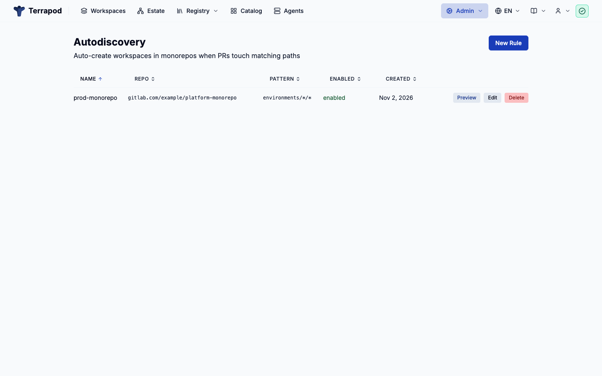

# Workspace Autodiscovery

Modelled on [Atlantis's `autodiscover`](https://www.runatlantis.io/docs/server-side-repo-config.html#autodiscover) feature, autodiscovery auto-creates a Terrapod workspace the first time a PR (or default-branch push) touches a path matching one of your rules. Designed for monorepos where pre-provisioning a workspace per directory is impractical.



## When you'd want this

- A monorepo with hundreds of nested terraform root modules (one per AWS account, one per environment, etc.).
- New roots are added regularly via PRs, and you don't want every PR-author to also have to create a Terrapod workspace.
- You're happy giving every discovered directory the *same* execution defaults — agent pool, terraform version, resource requests, default labels, owner.

## When you wouldn't

- You only have a handful of long-lived workspaces. Just create them.
- Different directories need different workspace configuration that can't be expressed by a single rule.

## How it works

```
┌─────────────────┐       ┌──────────────────────┐       ┌─────────────────────┐
│ PR opened       │  PR's │ Poller scans changed │ Match │ Workspace created   │
│ on branch X     ├──────►│ files vs rules       ├──────►│ with rule's         │
│                 │ files │ (pattern + ignore)   │       │ template defaults   │
└─────────────────┘       └──────────────────────┘       └─────────────────────┘
                                                                    │
                                                                    ▼
                                                         ┌─────────────────────┐
                                                         │ Next poll cycle     │
                                                         │ runs the speculative│
                                                         │ plan as normal      │
                                                         └─────────────────────┘
```

Autodiscovery runs on every poll cycle (default 60s) and on every webhook-triggered immediate poll for the matching repo. It only creates workspaces — the existing PR/branch poll logic queues the speculative plan on the next pass.

## GitHub App permissions

**No new permissions required.** The same `Contents: read`, `Pull requests: read & write`, and `Metadata: read` you've already granted for VCS integration cover autodiscovery (file listing on PRs uses `Pull requests: read`). Existing GitLab access tokens with `read_api` + `read_repository` (or `api`) work without changes.

## Rule schema

Rules are scoped to a single VCS connection + repo. A rule has:

| Field | Type | Required | Description |
|---|---|---|---|
| `name` | string | yes | Display name for the rule. Unique per VCS connection. |
| `vcs-connection-id` | UUID | yes | Reference to an existing VCS connection. |
| `repo-url` | string | yes | Full repo URL, e.g. `https://github.com/myorg/monorepo`. |
| `branch` | string | no | Branch the rule scopes to. Empty = default branch. |
| `pattern` | string | yes | Glob matched against changed file paths (gitignore-style with `**` support). |
| `ignore-patterns` | string[] | no | Globs filtered out before pattern matching. |
| `engine` | enum | no | `terraform` (default) or `pulumi`. A rule discovers one engine and ignores the other's files; write two rules to cover both. |
| `pulumi-bind-plan` | bool | no | Templated onto created workspaces. **Pulumi rules only** — a `422` on a Terraform rule. |
| `name-template` | string | no | Template for derived workspace names. Default: directory path with `/` replaced by `-`. |
| `enabled` | bool | no | Default `true`. |
| `execution-mode` | enum | no | Must be `agent` (default). Autodiscovery is VCS-driven; `local` mode would create workspaces with queued runs and no executor. |
| `agent-pool-id` | UUID | no | Inherited by created workspaces in `agent` mode. |
| `execution-backend` | enum | no | `tofu` or `terraform`. Default `tofu`. |
| `engine-version` | string | no | Default `1.13`. Also accepted as `terraform-version`. |
| `resource-cpu` / `resource-memory` | string | no | Defaults `1` / `2Gi`. |
| `parallelism` | integer | no | Concurrent engine operations on workspaces this rule creates, in the plan/apply phase. Default `10`. |
| `configure-parallelism` | integer | no | Concurrent hosts a configure drives on workspaces this rule creates (ansible's `forks`). Omit and they inherit their `parallelism`. |
| `ansible-version` | string | no | ansible-core **line** for workspaces this rule creates -- a line rather than a full version because the execution-environment image tag is the line, and the line is what decides which target Pythons their playbooks can reach. Default `2.21`. There is no format rule beyond the deployment's pre-release policy, so a full patch version is accepted too. Send an explicit empty string to have the created workspaces inherit the deployment default instead, as with `engine-version`. |
| `auto-apply` | bool | no | Default `false`. Superseded by `auto-apply-mode` when that is set. |
| `auto-apply-mode` | string | no | Conditional auto-apply templated onto created workspaces: `never`, `always`, `create`, `create_update`. `create`/`create_update` never auto-apply a plan that destroys or replaces a resource. Set this **or** `auto-apply`, not both (422). |
| `on-directory-delete` | enum | no | `flag` (default — mark `pending_deletion`, require explicit operator action) or `destroy` (opt-in — real destroy run then archive). See the Lifecycle section (#314). |
| `oidc-audiences` | map | no | Templated onto created workspaces: the cloud-identity audience override for [per-workspace cloud identity](cloud-identity.md), keyed on the provider configuration (`aws`, `aws.west`). **A rule returns what it stores, where a workspace returns the map MERGED over the deployment catalogue** — the same attribute name with different read semantics, because a rule is a template and has nothing to merge against until a workspace exists. |
| `labels` | map | no | Inherited by created workspaces — feeds Terrapod's label-based RBAC and filtering. Reserved keys (`status`, `flag`, `locked`, `owner`) are rejected with `422` at rule create/update — they are virtual filter terms and would otherwise produce workspaces that can't be saved. |
| `owner-email` | string | no | Inherited by created workspaces; if unset, created workspaces have no owner and label-RBAC alone determines access. |
| `var-files` | list | no | Var-file paths set on every created workspace. |
| `run-task-templates` | list | no | Run-task specs (`{name, url, hmac-key?, stage, enforcement-level?, enabled?}`) materialised onto every created workspace — same shape as the bulk-update `run-tasks`. Define a policy gate once; it auto-applies to all future workspaces, and to existing ones only when an edit [asks for it](#updating-a-rule-and-rolling-it-out-to-existing-workspaces) (#318). |
| `notification-templates` | list | no | Notification specs (`{name, destination-type, url?, token?, triggers?, email-addresses?, enabled?}`) materialised onto every created workspace. |
| `execution-hook-templates` | list | no | [Execution hook](execution-hooks.md) ids (`hook-<uuid>`) associated with every created workspace, so discovered workspaces inherit their hooks automatically (#672). Ids that no longer exist are skipped at creation. |
| `security-scan-enforcement` | string | no | [Security-scan](security-scanning.md) enforcement on every created workspace: `off`, `advisory` (default), or `enforced`. Accepted on a Terraform/OpenTofu rule, which is what can be scanned. On a **Pulumi** rule it is refused outright with `422`, as is `security-scan-engine` -- a Pulumi run is not security-scanned, so a scan setting on the template would never apply. That is stricter than a workspace, which accepts `off` on a Pulumi workspace rather than refusing the attribute (#1763, #1570). |
| `security-scan-engine` | string | no | Which scanner runs on created workspaces: `checkov` (default), `trivy`, or `both` (#1763). |
| `security-scan-severity-threshold` | string | no | Lowest severity counted as a finding on created workspaces: `critical`, `high` (default), `medium`, `low` (#1763). |
| `security-scan-skip-rules` | list | no | Scanner rule ids (Checkov `CKV_*` / Trivy `AVD-*`) ignored on every created workspace (#1763). |
| `ai-summary-mode` | string | no | AI plan-summary opt-in on created workspaces: `default` (follow the deployment setting), `enabled`, `disabled` (#1763). |
| `ai-policy-mode` | string | no | AI **policy gate** opt-in on created workspaces: `default`, `enabled`, `disabled`. A mandatory deployment-wide gate ignores `disabled` — it can only opt a workspace out of an *advisory* verdict (#1766). |
| `ai-summary-context` | string | no | Free-text context added to the AI prompt for every created workspace. Max 4000 characters (#1763). |
| `terragrunt-enabled` / `terragrunt-version` | bool / string | no | Run Terragrunt on created workspaces, and at which version (#1763). |
| `vcs-workflow` | string | no | `merge_then_apply` (default) or `apply_then_merge` on created workspaces (#1763). |
| `auto-merge` / `auto-merge-strategy` | bool / string | no | Merge the PR after a successful apply, and how (`merge`, `squash`, `rebase`) (#1763). |
| `drift-detection-enabled` / `drift-detection-interval-seconds` | bool / int | no | Scheduled drift checks on created workspaces. **Defaults enabled**, because every autodiscovered workspace is VCS-connected and the workspace-creation path enables it for those — defaulting off would have silently disabled drift detection across every discovered directory (#1763). |
| `drift-ignore-rules` | list | no | Address/attribute-path patterns whose drift is ignored on created workspaces (#1763). |
| `scheduled-configure-enabled` / `scheduled-configure-cron` / `scheduled-configure-timezone` | bool / string / string | no | Run a [scheduled configure](ansible-configure.md) on created workspaces: five-field cron, read in an IANA zone (default `UTC`). **Default off** — a schedule has no sensible default expression. A workspace created with it on waits for the next occurrence rather than configuring at once. |
| `plan-expiry-seconds` | int | no | Auto-discard an unconfirmed plan after this many seconds. Unset means no expiry (#1763). |
| `slack-channel` | string | no | Slack channel for run notifications on created workspaces; empty is silent (#1763). |
| `debug-mode` | bool | no | Hold a **failed** runner pod open on created workspaces so an operator can `kubectl exec` into it. Defaults **off** — a held pod keeps the run's credentials and decrypted variables for the deployment's linger window, so it is worth enabling deliberately rather than across every discovered directory (#1764). See [runners.md → Debug mode](runners.md#debug-mode-inspecting-a-failed-runner-pod). |
| `allow-fork-pr-plans` | bool | no | Let a pull request opened **from a fork** get a speculative plan on created workspaces. Defaults OFF — such a plan runs the fork author's code with the workspace's credentials, and they have neither write access nor the ability to merge. Set it here so the choice survives the next directory autodiscovery picks up; pull requests from branches in the repository itself always plan either way. See [vcs-integration.md → Pull requests from forks](vcs-integration.md#pull-requests-from-forks). |

## Pattern syntax

Rules use gitignore-style globs. Patterns are matched against the **full file path** (e.g. `accounts/alpha/network/main.tf`).

| Token | Meaning |
|---|---|
| `*` | match anything within a single path segment (no `/`) |
| `**` | match zero or more path segments |
| `?` | match a single non-`/` character |
| `[abc]` | match one of `a`, `b`, `c`; `[!abc]` = NOT one of those |

Only terraform configuration files (`*.tf`, `*.tfvars`, `*.tf.json`, `*.tfvars.json`, `*.hcl`) trigger autodiscovery. README/CI/script changes are filtered out before pattern matching.

## Engines: Terraform or Pulumi (#1570)

A rule discovers **one engine**, set by its `engine` field and defaulting to
`terraform`. A rule matches only that engine's files and ignores the rest, so a
directory holding both a `Pulumi.yaml` and `.tf` files is claimed by whichever
rule is looking for it.

**To discover both, write two rules.** There is deliberately no "both" setting:
one rule, one engine, so the template fields and the workspaces it creates have
a single unambiguous meaning.

| `engine` | Files it matches | Unit of discovery |
|---|---|---|
| `terraform` (default) | `*.tf`, `*.tfvars`, `*.tf.json`, `*.tfvars.json`, `*.hcl` | the directory |
| `pulumi` | `Pulumi.<stack>.yaml` / `.yml` | the **(directory, stack)** pair |

That last column is the difference that matters. A Pulumi project normally
declares several stacks side by side:

```
infra/payments/
  Pulumi.yaml          <- the project. Declares no stack, so creates no workspace.
  Pulumi.dev.yaml      <- one workspace
  Pulumi.prod.yaml     <- a second workspace, same directory
```

So one directory yields **as many workspaces as it has stack files**, where a
Terraform directory yields exactly one. `Pulumi.yaml` itself is not a unit of
state and never creates a workspace on its own.

### Engine-specific template fields

A rule may only template what its engine can use, and is refused with a `422`
otherwise rather than storing a value that could never apply:

- `pulumi-bind-plan` is accepted **only** on a Pulumi rule.
- `security-scan-enforcement` and `security-scan-engine` are accepted **only**
  on a Terraform rule, and a Pulumi rule defaults enforcement to `off`. A Pulumi
  run is not security-scanned, so templating a scan would record a gate that
  never runs.

## How the workspace is named

The created workspace's `working-directory` is the directory containing the matched terraform file. The default name is that directory with `/` replaced by `-`:

```
accounts/alpha/network/main.tf  →  workspace `accounts-alpha-network` (working_directory = `accounts/alpha/network`)
```

If the default would collide with an existing unrelated workspace, Terrapod logs a warning and skips creation. Tighten `name-template` to disambiguate:

```
name-template: "monorepo-{path}"   →  monorepo-accounts-alpha-network
name-template: "ws-{root}"         →  ws-accounts-alpha-network  ({root} preserves /, sanitiser maps to -)
```

`{path}` is the dashed directory; `{root}` is the directory with `/` preserved. Names are sanitised to `[A-Za-z0-9_-]` and capped at 90 chars (the workspaces.name column limit).

### Pulumi workspaces are named `project::stack`

A discovered Pulumi stack is named in the form the rest of Terrapod already uses
for a Pulumi workspace, so a discovered one is indistinguishable from a
hand-created one:

```
infra/payments/Pulumi.dev.yaml  →  workspace `payments::dev`  (working_directory = `infra/payments`, stack = `dev`)
```

**The project half is the DIRECTORY name, not the `name:` field inside
`Pulumi.yaml`.** Matching is pure path logic — it runs over every path in every
PR diff — so honouring the declared name would mean fetching and parsing a file
from the VCS inside that loop. The stack half is always exact, because it comes
from the filename.

The consequence worth knowing: a project declared `name: payments-api` in a
directory called `infra/payments` is discovered as `payments::dev`, not
`payments-api::dev`. If you want the two to agree, name the directory after the
project.

`name-template` does not apply to Pulumi rules — the `project::stack` form is
what addresses the stack.

## Created workspace properties

A workspace created by a rule:
- Inherits all template fields above.
- Has its `var-files`, plus a `run-task` / `notification-configuration` for each entry in the rule's `run-task-templates` / `notification-templates`, materialised at creation — so the workspace is fully configured with no second pass (#318).
- Inherits **every** workspace setting the rule templates — security scanning, AI plan summary, Terragrunt, VCS workflow and auto-merge, drift detection, plan expiry and the Slack channel — so a rule covering hundreds of directories configures them all at creation rather than one workspace at a time (#1763). What a rule deliberately does *not* template (the working directory, trigger prefixes and provenance, all computed at materialisation) is recorded with its reason in the test suite, so the next setting cannot go missing here silently.
- Has `vcs-connection-id`, `vcs-repo-url`, `vcs-branch` set from the rule.
- Has `working-directory` set to the matched file's parent.
- Has `trigger-prefixes` set to `[working_directory]` so subsequent PRs that touch the same dir route to the same workspace via the regular PR-scan path (not via re-running autodiscovery).
- Tracks `autodiscovery-rule-id` so you can audit which rule created it.
- Is seeded with the **tracked-branch HEAD** as its last-seen commit (`vcs-last-commit-sha`). Autodiscovery is PR-driven — the matched directory exists on the PR branch but not yet on the tracked branch — so without this baseline the next branch poll would fire a full plan+apply against a branch where the directory doesn't exist, which errors. With the baseline, the speculative plan-only run for the open PR still happens, and the first real plan+apply fires when the tracked branch actually advances (typically the PR merge).
- Is **not** changed when you later edit the rule — unless that one edit asks for it; see [Updating a rule](#updating-a-rule-and-rolling-it-out-to-existing-workspaces).

If you delete the rule later, existing workspaces keep working — the foreign key sets to NULL on cascade.

## Updating a rule and rolling it out to existing workspaces

Editing a rule changes what **future** workspaces get. By default it touches no existing workspace. To roll an edit out to the workspaces the rule already created, ask for it in that one request: `PATCH /api/v1/autodiscovery-rules/{id}` takes two options, beside `data` in the body.

| Option | Default | Meaning |
|---|---|---|
| `propagate` | `false` | Also apply the fields **this update changes** to the workspaces the rule created. |
| `dry_run` | `false` | Preview what `propagate` would do and persist **nothing** — neither the rule edit nor any workspace change. Requires `propagate`; on its own it is refused with `422`. |

```json
{
  "data": {"type": "autodiscovery-rules", "attributes": {"engine-version": "1.14"}},
  "propagate": true,
  "dry_run": true
}
```

Both are per-request, and there is deliberately **no persistent rule attribute** for them. A change that writes across a fleet should be a deliberate act with a blast radius you can see before it happens; a standing setting would turn every later edit of the rule into a fleet write. For the same reason the OpenTofu/Terraform provider has no attribute for it. Run a `dry_run` first: it reports what the request would do to the workspaces as they are now, then rolls back. The real request re-judges the workspaces when it applies, so one edited in between can land differently.

In Go, `UpdateAutodiscoveryRuleWithPropagation` in go-terrapod sends `propagate` (and `dry_run` via `PropagateOptions`) and returns the rule with its `Propagation`; `UpdateAutodiscoveryRule` is unchanged and never propagates.

### What is updated

- **Only fields this update changes.** A field you resend unchanged, or spell as another form of "unset" (`null` for `""`, `[]` for no list), is not a change and touches nothing.
- **Only where the workspace still matches the rule.** A workspace's value is replaced only if it **equals the rule's previous value** — it has not been edited since the rule set it. Otherwise someone chose that value on purpose, and it is skipped (reported as `customised`). A workspace that already equals the **new** value is `unchanged`. Each field is judged on its own, so one workspace can be updated for one field and customised for another.
- **The whole value is compared; values are never merged.** This matters most for `labels`, which drive access: a workspace whose labels are not exactly the rule's previous labels is customised, never given the new labels on top of its own. Lists (`var-files`, `ansible-collections`, `playbooks`, …) work the same way.
- **Run tasks and notifications** (`run-task-templates`, `notification-templates`) are compared per name: a name that is **new to the rule** (not in its previous list) and absent from the workspace is inserted; a name the workspace has is updated if it equals the rule's previous spec, left alone if it already equals the new one, and customised and skipped otherwise. A name the rule **already had** but the workspace lacks is treated as a deliberate removal: it is reported as customised and is not re-created. So a workspace that predates a template the rule gained earlier without propagation does not receive it from a later edit. One customised name skips that whole template field for that workspace. Removing an entry from the rule's list does **not** remove it from workspaces.
- **The scheduled-configure settings are judged as one unit.** `scheduled-configure-enabled`, `scheduled-configure-cron` and `scheduled-configure-timezone` move together or not at all, because a zone shifts when a cron fires and the flag switches it on. An edit to any one of them judges all three, the ones you did not edit against the rule's own value. If a workspace differs from the rule's previous schedule in any of the three, it is skipped for all of them and reported as customised. So a workspace with its own cron keeps its own cron **and** its own zone and on/off state. A workspace that takes the change and is switched on records the baseline, so its first run is the next occurrence, not an immediate one.
- **Only active workspaces.** Archived and pending-deletion workspaces are skipped and counted in `skipped_lifecycle`.
- **No runs are triggered.** It is a settings write; each workspace picks the change up on its next normal run, and a scheduled configure you propagate fires at its own next occurrence. One qualification, for `oidc-audiences` only: a run already in `planned` on an updated workspace is auto-discarded at its next confirm, as with [bulk update](api-reference.md#bulk-update).

Every templated setting in the [rule schema](#rule-schema) propagates except the following, which are never touched on an existing workspace:

| Rule field | Why |
|---|---|
| `id`, `created-at`, `updated-at`, `first-scan-at` | the rule's own bookkeeping |
| `name` | the rule's own name; each workspace's name was derived at creation |
| `name-template` | applies only to names derived at creation; existing workspaces keep theirs |
| `vcs-connection-id`, `repo-url`, `branch` | the rule's own connection, repository and branch; changing them does not re-home a workspace |
| `pattern`, `ignore-patterns` | decide which directories are discovered, not a workspace setting |
| `enabled` | turns the rule's discovery on or off, not a workspace setting |
| `on-directory-delete` | the rule's own lifecycle policy, read at discovery time |
| `engine` | pins what the rule discovers; an existing workspace's engine is never changed |
| `owner-email` | never bulk-settable: setting an owner can grant admin on the workspace |
| `storage-location` | fixed when a workspace is created: its objects live there, so it is never changed |
| `execution-hook-templates` | no bulk-update support yet |

A workspace's working directory and trigger prefixes are per-workspace identity and are not rule fields.

### Safety

- **All or nothing.** The rule edit and every workspace change commit together or not at all. Propagation applies the same checks as [bulk update](api-reference.md#bulk-update), judged against the workspaces the update would change; a refusal (for example `security-scan-enforcement: enforced` reaching a Pulumi workspace) refuses the **whole** request with `422` and leaves the rule unchanged.
- **A customised run kind is never overwritten.** If the update changes `default-run-kind`, a workspace with its own different kind is skipped for that field. If the same update also changes `plan-apply-enabled` or `configure-enabled` in a way that would drop that workspace's kind, the whole request is refused with `422` naming the workspaces — set their `default-run-kind` first, or leave the operation flags alone. Where the update does not name a kind and a flag change drops a workspace's stored kind (as editing the workspace would), the change is applied and shown in the preview as a `default_run_kind` entry in that workspace's `diff`.
- **Admin only**, like the rest of the rule API.
- **Two secret keys are redacted in the preview.** In `meta.propagation`, a run task's `hmac-key` and a notification's `token` appear as `<set>` or `<unset>`. Every other spec key is shown as it is stored in `customised` — including a notification's destination `url`, which for a chat webhook is itself a credential. `would_change` lists template names only. The rule in `data` carries its templates exactly as Show returns them, secrets included.

### Reading the result

The response is the updated rule in `data` — on a `dry_run`, the rule as it would be with the unsaved edit applied — plus `meta.propagation`, which sorts every matched workspace into:

- `would_change` — updated (or, on a `dry_run`, would be), with the same per-workspace `diff` bulk update reports. On a real request this key lists what **was** changed.
- `customised` — skipped for the listed fields, each with the workspace's `current` value, the rule's `previous` one and the `new` one.
- `unchanged` — already at the new value.

A workspace customised on one field and updated on another is in both lists. An update that changes no propagated field (say, only `pattern`) leaves every active workspace under `unchanged`. The full shape is in the [API reference](api-reference.md#update-rule).

### Auditing a rollout

Each workspace a request changes gets one `workspace.rule_propagate` [audit-log](api-reference.md#list-audit-log-entries) row. Its `detail` names the rule and the changed fields, and its `request-id` is the `PATCH`'s own. The `PATCH` also writes its usual request-level row (action `PATCH`) under the same `request-id`; a `dry_run` writes that row too, but no `workspace.rule_propagate` rows. List with `filter[action]=workspace.rule_propagate` and group on `request-id` to answer "what did that rule change do".

## Lifecycle: rename / delete / orphan (#314)

Autodiscovered workspaces are reconciled as the repo evolves. **Safe by default — nothing is destroyed unless a rule explicitly opts in.**

- **Directory renamed** (`git mv old/ new/`): detected from the provider's per-file rename info. On the PR, an informational comment is posted. When the rename reaches the tracked branch the existing workspace is **moved in place** (`working-directory`/`trigger-prefixes`/templated name updated) — **state and history are preserved, nothing is destroyed**. A rename whose files fan out to multiple directories (split/merge) is *ambiguous* — it is **not** auto-applied; the workspace is flagged for a human and the new directories autodiscover normally.
- **Directory deleted**: on the open PR a **speculative `plan -destroy`** is queued and a comment posted so reviewers see the blast radius (no mutation). When the deletion reaches the tracked branch — *and only after re-verifying the directory is actually gone from the tree* — the rule's **`on-directory-delete`** policy applies:
  - `flag` (default, safe): the workspace is marked `pending_deletion` and **requires an explicit operator action**. Never auto-destroyed.
  - `destroy` (opt-in, for ephemeral envs): a real destroy run is queued; on success the workspace is **archived** (soft-deleted, retained for audit). A *failed* destroy is auto-retried a bounded number of times (`runners.lifecycleDestroyRetries`, default 2) — `terraform destroy` is transiently flaky and re-running is safe (incremental) — and the workspace is archived only on a **successful** destroy, so retries never lose data.
- **Origin PR closed unmerged / no longer matching**: the workspace is an orphan (its directory never reached the tracked branch). If it **never applied state** (zero state versions) it is **auto-archived**; if it **has state** it is flagged `pending_deletion` for a human. Never silently destroyed.

### On a Pulumi rule the unit is the stack, not the directory

Everything above applies per **stack file**, because a Pulumi workspace is one
stack:

- Removing `Pulumi.dev.yaml` while `Pulumi.prod.yaml` stays is **one workspace
  deleted**, and the directory is untouched. Read as a directory change it would
  look like nothing was deleted at all, and the policy would never fire.
- Before any flag or destroy, the re-verification checks that **that stack's own
  file** is gone from the tracked-branch tree — not the directory, which its
  siblings keep alive.
- A rename carries the stack with it, and the workspace is renamed to match the
  new `project::stack`.

**Rename detection is deliberately stricter for Pulumi.** For Terraform, a
rename can be inferred when a directory's files disappear and exactly the same
basenames appear in one other directory — which is what survives a squash merge,
where per-file rename information is lost. A stack is a *single* file, so there
is no such set to compare: a removed stack alongside an added one is
indistinguishable from a delete plus an unrelated create.

So for a Pulumi rule a rename is recognised **only** from explicit rename
information, and a removal that coincides with any addition in the same
directory is treated as **ambiguous — flagged for a human, never deleted**. The
asymmetry is on purpose: a missed rename costs you a flagged workspace, and a
missed ambiguity costs you a destroyed one.

`lifecycle-state` (`active` | `pending_deletion` | `archived`) and `lifecycle-reason` are exposed on the workspace and surfaced in the UI. All transitions are audited (`autodiscovery.workspace_moved` / `.pending_deletion` / `.destroy_queued` / `.archived` / `.rename_conflict`).

## Example

A monorepo for ~2000 AWS accounts in this shape:

```
accounts/
  alpha/network/main.tf
  alpha/compute/main.tf
  beta/network/main.tf
  ...
modules/
  vpc/main.tf      # reusable module — NOT a discoverable root
```

Rule:

```yaml
name: monorepo
vcs-connection-id: vcs-019e0e7b-a6de-7ea6-8b27-3a983c0a098e
repo-url: https://github.com/myorg/monorepo
branch: main
pattern: accounts/*/**/*.tf
ignore-patterns:
  - modules/**
execution-mode: agent
agent-pool-id: apool-019e01db-a2a3-7494-afe0-1a8ecf70b3eb
labels:
  managed-by: monorepo-autodiscover
owner-email: platform@example.com
```

Outcome:

| PR change | Result |
|---|---|
| `accounts/alpha/network/main.tf` | Workspace `accounts-alpha-network` auto-created (if it didn't exist) |
| `accounts/gamma/dns/main.tf` | New workspace `accounts-gamma-dns` auto-created |
| `modules/vpc/main.tf` | No workspace created (matches ignore pattern) |
| `README.md` | No workspace created (not a terraform file) |

### A Pulumi monorepo

```
infra/
  payments/
    Pulumi.yaml          # project — creates no workspace on its own
    Pulumi.dev.yaml
    Pulumi.prod.yaml
  search/
    Pulumi.yaml
    Pulumi.dev.yaml
```

Rule:

```json
{
  "data": {
    "type": "autodiscovery-rules",
    "attributes": {
      "name": "pulumi-infra",
      "vcs-connection-id": "vcs-<uuid>",
      "repo-url": "https://github.com/myorg/monorepo",
      "engine": "pulumi",
      "pattern": "infra/*/Pulumi.*.yaml",
      "execution-mode": "agent",
      "agent-pool-id": "apool-<uuid>"
    }
  }
}
```

Discovers **three** workspaces — `payments::dev`, `payments::prod` and
`search::dev` — two of them from the same directory. Add a second rule with
`engine: terraform` if the same repo also holds Terraform roots.

## API

Admin-only CRUD at `/api/v1/autodiscovery-rules`:

```
GET    /api/v1/autodiscovery-rules
POST   /api/v1/autodiscovery-rules
GET    /api/v1/autodiscovery-rules/{id}
PATCH  /api/v1/autodiscovery-rules/{id}
DELETE /api/v1/autodiscovery-rules/{id}
```

`PATCH` also takes the per-request `propagate` and `dry_run` options that [roll an edit out to existing workspaces](#updating-a-rule-and-rolling-it-out-to-existing-workspaces). Without them it changes the rule alone.

### Preview and on-demand scan

Beyond passively waiting for the poller, you can dry-run a rule and provision on demand:

```
GET  /api/v1/autodiscovery-rules/{id}/preview   # what a saved rule would create — no side effects
POST /api/v1/autodiscovery-rules/preview        # same, for an unsaved rule (Create body) — iterate before saving
POST /api/v1/autodiscovery-rules/{id}/scan      # walk now and actually create the workspaces (idempotent)
```

Preview walks the tracked branch and returns, per directory: `workspace_name`, `working_directory`, `collision` (would no-op — a workspace is already bound to that directory, or the derived name is taken), and `existing_autodiscovered` (the no-op is a reuse of a workspace this same rule already made). The admin UI surfaces this as a per-row badge (Create / Skip already-discovered / Skip name-collision) and a "Provision N workspaces" confirm whose count is exactly the non-colliding rows. A `413` means the provider truncated the repo tree (too large to scan in one pass). `scan` force-enables the rule for the call so an explicit operator action doesn't silently no-op on a disabled rule.

JSON:API request body example:

```json
{
  "data": {
    "type": "autodiscovery-rules",
    "attributes": {
      "name": "monorepo",
      "vcs-connection-id": "vcs-019e0e7b-...",
      "repo-url": "https://github.com/myorg/monorepo",
      "pattern": "accounts/*/**/*.tf",
      "ignore-patterns": ["modules/**"],
      "execution-mode": "agent",
      "agent-pool-id": "apool-019e01db-...",
      "labels": {"managed-by": "monorepo-autodiscover"},
      "owner-email": "platform@example.com"
    }
  }
}
```

## Operational notes

- **Lifecycle of discovered workspaces**: workspaces persist after the source directory is deleted. Operators can archive/delete via the normal workspace API.
- **Race-safety**: idempotent. Concurrent poll cycles trying to create the same workspace fall through to a "found existing" branch.
- **Failure isolation**: a misconfigured rule (bad repo URL, GitHub auth failure, rate limit) is logged and skipped; other rules in the same cycle continue.
- **Observability**: every autodiscovery action emits a structlog entry — grep API logs for `Autodiscovery created workspace` and `Autodiscovery name collision`.

## Related

- [Module autodiscovery](registry.md#module-autodiscovery): the registry's counterpart. Rules that find the modules (the root and any submodules) in a repository, or in every repository of an org, group or name pattern, and register them.
- Atlantis autodiscover docs: <https://www.runatlantis.io/docs/server-side-repo-config.html#autodiscover>
- Original feature request: <https://github.com/mattrobinsonsre/terrapod/issues/283>
